<!--
  Blockcraft profile: Minecraft-style x cyber pixel theme. All art is original pixel art (no game assets).
  Static images: assets/craft/<name>.svg (desktop) and assets/craft/<name>-m.svg (mobile, used below 640 px),
  generated by tools/make_craft.py. Local preview: open preview.html.
  LIVE blocks load images that .github/workflows/snake.yml regenerates daily from real GitHub data
  on the `output` branch. Each LIVE block is optional: delete it to drop that integration.
-->

  <picture>
    <source media="(max-width: 640px)" srcset="https://raw.githubusercontent.com/Qcutedev/Qcutedev/main/assets/craft/banner-m.svg">
    
  </picture>

 

  <picture>
    <source media="(max-width: 640px)" srcset="https://raw.githubusercontent.com/Qcutedev/Qcutedev/main/assets/craft/about-m.svg">
    
  </picture>

  <picture>
    <source media="(max-width: 640px)" srcset="https://raw.githubusercontent.com/Qcutedev/Qcutedev/main/assets/craft/skills-m.svg">
    
  </picture>

 

  <picture>
    <source media="(max-width: 640px)" srcset="https://raw.githubusercontent.com/Qcutedev/Qcutedev/main/assets/craft/projects-m.svg">
    
  </picture>

  <a href="https://github.com/Qcutedev/rideros-ai">
    <picture>
      <source media="(max-width: 640px)" srcset="https://raw.githubusercontent.com/Qcutedev/Qcutedev/main/assets/craft/card-rideros-m.svg">
      
    </picture>
  </a>

  <a href="https://github.com/Qcutedev/Project-Sleep">
    <picture>
      <source media="(max-width: 640px)" srcset="https://raw.githubusercontent.com/Qcutedev/Qcutedev/main/assets/craft/card-sleepwise-m.svg">
      
    </picture>
  </a>

  <a href="https://github.com/Qcutedev/web-shopping">
    <picture>
      <source media="(max-width: 640px)" srcset="https://raw.githubusercontent.com/Qcutedev/Qcutedev/main/assets/craft/card-marketplace-m.svg">
      
    </picture>
  </a>

  <a href="https://github.com/Qcutedev/ml-deployment-lab">
    <picture>
      <source media="(max-width: 640px)" srcset="https://raw.githubusercontent.com/Qcutedev/Qcutedev/main/assets/craft/card-mllab-m.svg">
      
    </picture>
  </a>

 

<!-- LIVE: player stats, real GitHub data regenerated daily by .github/workflows/snake.yml (tools/make_stats.py) -->

  <picture>
    <source media="(max-width: 640px)" srcset="https://raw.githubusercontent.com/Qcutedev/Qcutedev/output/stats-m.svg">
    
  </picture>

<!-- /LIVE -->

 

<!-- LIVE: contribution world map, the snake is regenerated daily by .github/workflows/snake.yml (Platane/snk) -->

  <picture>
    <source media="(max-width: 640px)" srcset="https://raw.githubusercontent.com/Qcutedev/Qcutedev/main/assets/craft/snake-title-m.svg">
    
  </picture>

  <picture>
    <source media="(prefers-color-scheme: dark)" srcset="https://raw.githubusercontent.com/Qcutedev/Qcutedev/output/snake-dark.svg">
    
  </picture>

<!-- /LIVE -->

 

  <picture>
    <source media="(max-width: 640px)" srcset="https://raw.githubusercontent.com/Qcutedev/Qcutedev/main/assets/craft/footer-m.svg">
    
  </picture>

